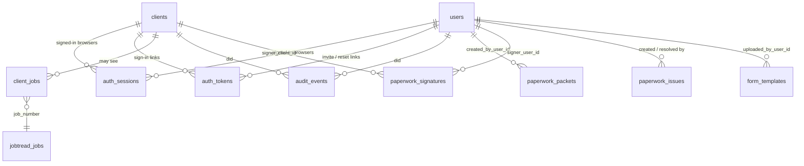

# Database and accounts

The hub keeps one Postgres database: the built-in local copy (PGlite) on the shop
PC today, hosted Postgres (Neon) later. Same tables either way; migrations in
`drizzle/` run on start.

## How the data is split

| Area | Tables | Source of truth |
| --- | --- | --- |
| Jobs and production | `jobtread_jobs`, `jobtread_syncs` | JobTread (read-only copy, rebuilt each sync) |
| Folder steps | `jobs`, `folders`, `folder_steps`, `special_orders`, `import_batches` | Manager Special Orders paste (rebuilt each paste) |
| Reports | `saved_reports` | The hub |
| Sales paperwork | `form_templates`, `paperwork_packets`, `paperwork_docs`, `paperwork_files`, `paperwork_signatures`, `paperwork_issues` | The hub |
| **Accounts** | `users`, `clients`, `client_jobs`, `auth_sessions`, `auth_tokens`, `audit_events` | The hub |

Jobs are joined by **job number**, never by a row id, because the JobTread and
Manager copies are replaced on every refresh.

## Staff accounts

- **`users`**: email (lowercased, the sign-in name), name, initials (as written
  in Manager's REF column, so step sign-offs can be tied to a person), role,
  departments, password hash, on/off.
- **Roles**: `admin` (everything, including staff accounts), `manager`
  (everything else), `staff` (shared views plus their departments' work).
- **Departments**: sales/design, front office, engineering CAD, purchasing,
  price verification, QA, production, installation. A person can be in several.
- **Permissions** live in code, `src/lib/auth/permissions.ts`, as a list of
  actions and the departments allowed each one. The Staff page shows the
  table. Changing who can do what is a one-line, reviewed edit, no migration.
- People are switched off, never deleted, so their history keeps a name.
  Switching someone off or changing their access signs them out everywhere.
- Passwords: scrypt with a per-password salt, 10+ characters. Ten wrong tries in
  15 minutes locks that email for 15 minutes.
- New staff get a one-time invite link (7 days) to choose their own password.
  Admins can make a password reset link (2 hours). If email is set up the
  invite is also emailed.

## Client sign-in

Clients never get a password. Staff with "clients" access add the client, link
their job numbers, and make a **one-time sign-in link**: text it, email it, or
open it on the client's phone during the appointment. One tap signs them in on
that device for 90 days.

- A link works once, for 3 days, and making a new one cancels the old one.
- The link page asks for a tap before it signs in, so email scanners that open
  links don't use it up.
- With email set up (`RESEND_API_KEY`, `EMAIL_FROM`), clients can also type
  their email at `/portal/sign-in` to get a fresh link. The answer is the same
  whether or not the email is on file.
- Clients only reach `/portal` and only see jobs in `client_jobs`. Staff pages
  send a client back to the portal.

## Sessions, links and the audit trail

- **`auth_sessions`**: one row per signed-in browser, for staff or a client.
  Only a SHA-256 of the cookie is stored, so a copy of the database can't sign
  anyone in. Deleting the row signs that browser out.
- **`auth_tokens`**: invite, password reset and client sign-in links, also
  stored hashed, marked used in the same statement that checks them.
- **`audit_events`**: who did what and when (sign-ins, failed sign-ins, invites,
  access changes, client links). Signatures and approvals should log here too.

## Turning it on

Nothing changes until the first account exists. Until then the app behaves as
before: open on the shop PC, or the shared `APP_PASSWORD` on a hosted copy.
Open `/setup` to make the owner's admin account (on a hosted copy it asks for
the shop password first, so a stranger can't claim it). From then on everyone
signs in as themselves and the shared password is no longer used.

## Next steps this design leaves room for

- Paperwork: fill `created_by_user_id`, `signer_user_id` / `signer_client_id`
  and the issue columns from the signed-in account, and let clients sign from
  the portal.
- Price book: catalog tables gated by `pricebook.view` / `pricebook.manage`.
- Client app synced with the designer during appointments: a short code or QR
  on the designer's tablet that issues a `client_login` token.
- Server actions written before accounts (import, reports, paperwork) rely on the
  page gate; add `requireStaff(...)` inside them as they're next touched.
