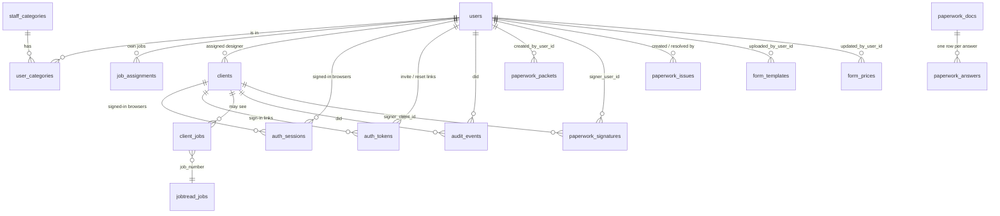

# Database and accounts

The hub keeps one Postgres database: the built-in local copy (PGlite) on the shop
PC today, hosted Postgres (Neon) later. Same tables either way; migrations in
`drizzle/` run on start.

## How the data is split

| Area | Tables | Source of truth |
| --- | --- | --- |
| Jobs and production | `jobtread_jobs`, `jobtread_syncs` | JobTread (read-only copy, rebuilt each sync) |
| Folder steps | `jobs`, `folders`, `folder_steps`, `special_orders`, `import_batches` | Manager Special Orders paste (rebuilt each paste) |
| Reports | `saved_reports` | The hub |
| Sales paperwork | `form_templates`, `paperwork_packets`, `paperwork_docs`, `paperwork_answers`, `form_prices`, `paperwork_files`, `paperwork_signatures`, `paperwork_issues` | The hub |
| **Accounts** | `users`, `staff_categories`, `notifications`, `designer_requests`, `user_categories`, `job_assignments`, `clients`, `client_jobs`, `auth_sessions`, `auth_tokens`, `audit_events` | The hub |

Jobs are joined by **job number**, never by a row id, because the JobTread and
Manager copies are replaced on every refresh.

### Built-in sales forms

The closet, pantry, office, wall bed, garage and laundry detail sheets and the
five work sheets are built into the app (`src/lib/forms/native`), so nothing
has to be uploaded. Each has a `form_templates` row found by `builtin_key`.
Every save writes the form's answers to `paperwork_answers` as one row per
question (job number, room, section, label, value, and a number when there is
one), so answers can be searched and reported across jobs.

Work sheet prices are not in the code, because the repository is public. They
live in `form_prices` (form, cell, value), loaded on Paperwork → Prices from
the company work sheet files, or on first start from a private
`private/form-prices.json` beside the app (ignored by git; `FORM_PRICES_FILE`
points elsewhere). Submitting a packet copies the prices into
`paperwork_docs.prices`, so signed paperwork keeps the prices it was signed
with. `scripts/build-worksheets.ts` turns a new revision of the work sheet
files into the built-in forms and a prices file.

## Staff accounts and categories

- **`users`**: email (lowercased, the sign-in name), name, initials (as written
  in Manager's REF column), account type, the name(s) written on their jobs,
  password hash, on/off.
- **Account type**: `admin` can do everything, including accounts and
  categories. `staff` can do what their categories allow.
- **`staff_categories`**: groups admins create and edit on the admin dashboard
  (`/admin/categories`). Each has a name, a description, a set of permissions,
  and which jobs it sees: **every job** or **only their own**. Ten starter
  categories are made with the first admin account (Manager, Designer, Sales
  office, Front office, Engineering CAD, Purchasing, Price verification, QA,
  Production, Installation); all of them can be renamed, changed or deleted.
- **`user_categories`**: who is in which category. A person can be in several
  and can do anything any of them allows. They see every job if any of their
  categories does, otherwise only their own.
- **Permissions** are the fixed list of actions the app checks
  (`src/lib/auth/permissions.ts`, grouped into Jobs, Sales, Paperwork,
  Operations, Clients and Admin). Categories are built from them; a new kind of
  action needs a code change because the app has to check it somewhere.
- Access is worked out on every request, so category and account changes apply
  at once. People are switched off, never deleted, so their history keeps a
  name; switching someone off signs them out everywhere.
- Passwords: scrypt with a per-password salt, 10+ characters. Ten wrong tries in
  15 minutes locks that email for 15 minutes. New staff get a one-time invite
  link (7 days); admins can make a password reset link (2 hours).

## Own work (designers)

People whose categories see only their own work see a job when:

1. their "name as written on jobs" matches the DESIGNER column of the Manager
   paste, the designer on a paperwork packet, or the JobTread user who uploaded
   the job's first photos (designers photograph every site at the appointment,
   sold or not, so this is how their leads are found),
2. an admin assigned the job to them (**`job_assignments`**), for leads and jobs
   their name isn't on yet,
3. it's linked to one of their clients (`clients.assigned_user_id`), or
4. they started paperwork for it.

That limit applies to the jobs board, schedule, reports, leads, folders,
paperwork (list, packets, sheets, files) and clients. JobTread has no designer
field. In a sample of 18 jobs, the first photos' uploader matched Manager's
designer on 16; the other two were uploaded by office accounts, which the
Manager name still covers.

### Jobs with no designer

After every JobTread refresh and Manager paste, the app looks for open jobs that
no designer account owns and that have no designer name in Manager. Each new
one triggers an alert (**`notifications`**, shown as **Alerts** in the menu,
and emailed when email is set up) to everyone whose categories include "Assign
designers to jobs". That's the starter **Front office manager** category; if
nobody has it, the admins are asked. **`designer_requests`** remembers which
jobs were already asked about, so each job is asked about once, and a big batch
(like the first run) becomes one summary alert. The **Needs designer** page
lists those jobs with whoever took their photos as a hint. Assigning one adds a
`job_assignments` row and clears its alert.

## Client sign-in

Clients never get a password. Staff with "clients" access add the client, pick their designer (a
designer's new clients are their own), link their job numbers, and make a **one-time sign-in link**: text it, email it, or
open it on the client's phone during the appointment. One tap signs them in on
that device for 90 days.

- A link works once, for 3 days, and making a new one cancels the old one.
- The link page asks for a tap before it signs in, so email scanners that open
  links don't use it up.
- With email set up (`RESEND_API_KEY`, `EMAIL_FROM`), clients can also type
  their email at `/portal/sign-in` to get a fresh link. The answer is the same
  whether or not the email is on file.
- Clients only reach `/portal` and only see jobs in `client_jobs`. Staff pages
  send a client back to the portal.

## Sessions, links and the audit trail

- **`auth_sessions`**: one row per signed-in browser, for staff or a client.
  Only a SHA-256 of the cookie is stored, so a copy of the database can't sign
  anyone in. Deleting the row signs that browser out.
- **`auth_tokens`**: invite, password reset and client sign-in links, also
  stored hashed, marked used in the same statement that checks them.
- **`audit_events`**: who did what and when (sign-ins, failed sign-ins, invites,
  access changes, client links). Signatures and approvals should log here too.

## Turning it on

Nothing changes until the first account exists. Until then the app behaves as
before: open on the shop PC, or the shared `APP_PASSWORD` on a hosted copy.
Open `/setup` to make the owner's admin account (on a hosted copy it asks for
the shop password first, so a stranger can't claim it). From then on everyone
signs in as themselves and the shared password is no longer used. The admin
dashboard is at `/admin`: overview, accounts (filter by category), categories,
and the activity log.

## Next steps this design leaves room for

- Paperwork: let clients sign from the portal (`signer_client_id`).
- Price book: catalog tables gated by `pricebook.view` / `pricebook.manage`.
- Client app synced with the designer during appointments: a short code or QR
  on the designer's tablet that issues a `client_login` token.
- Server actions written before accounts (import, reports, paperwork) rely on the
  page gate; add `requireStaff(...)` inside them as they're next touched.
